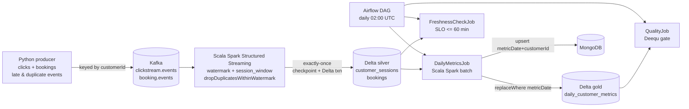

# Real-Time Commerce Events Pipeline (Scala · Spark · Kafka · Airflow)

An end-to-end data pipeline for clickstream and booking events. A Python producer
publishes to Kafka. A Scala Spark Structured Streaming job sessionizes clicks and
deduplicates bookings into Delta Lake. A daily Airflow DAG builds gold customer
metrics, writes them to Delta and MongoDB, and gates every partition with Deequ
data quality checks and a freshness SLO.



## Tech stack

| Area | Tools |
|---|---|
| Languages | Scala 2.12 (Spark jobs), Python 3.11 (producer, Airflow) |
| Processing | Apache Spark 3.5 (Structured Streaming + batch), Delta Lake 3.2 |
| Streaming | Apache Kafka 3.8 (KRaft) |
| Orchestration | Apache Airflow 2.10 |
| Storage | Delta Lake (silver/gold), MongoDB 7 (serving) |
| Data quality | Amazon Deequ, freshness SLO check |
| Testing / CI | ScalaTest, pytest, Airflow DAG integrity tests, GitHub Actions |
| Build / Run | sbt + sbt-assembly, Docker Compose |

## Repository layout

```
producer/                 Python Kafka producer (pure event logic in events.py, tested)
spark-jobs/               Scala sbt project
  src/main/scala/commerce/pipeline/
    model/                Case classes: data contracts for each layer
    config/               Environment-based configuration
    common/               SparkSession builder (Delta, UTC, AQE)
    transform/            Pure, unit-tested transformations
    jobs/                 StreamingIngestJob, DailyMetricsJob, QualityJob, FreshnessCheckJob
  src/test/scala/         ScalaTest suites
orchestration/            Airflow DAG, DAG integrity tests, Airflow image with Spark
docs/spec.md              Spec: data contracts, requirements, SLOs, acceptance criteria
docs/ai-review-log.md     Review log for AI-generated code
```

## Running locally

**Prerequisites:** Docker, Java 17, sbt 1.10+, Python 3.11.

Use Java 17. Spark 3.5 does not support Java 21. With SDKMAN:
`sdk install java 17.0.12-tem`.

```bash
# 1. Build and test the Scala jar
make jar                          # sbt test assembly

# 2. Start Kafka, MongoDB, the streaming job and Airflow
#    (Linux only: echo "AIRFLOW_UID=$(id -u)" > .env)
make up

# 3. Send simulated events (in another terminal)
make produce

# 4. Watch the streaming job write sessions
make logs

# 5. Open Airflow at http://localhost:8080
#    (the password is in `docker logs airflow`)
#    and trigger daily_customer_metrics
```

Run the Scala tests on their own with `cd spark-jobs && sbt test`, and the Python
tests with `pytest -q producer/tests`.

## Design decisions (and why)

| Decision | Why |
|---|---|
| **Event-time watermark (10 min) + session windows (30 min gap)** | Late events are still counted, and Spark can drop old state so memory stays bounded. |
| **`dropDuplicatesWithinWatermark` on `bookingId`** | The producer re-sends some bookings. Plain `dropDuplicates` on a stream keeps state forever. |
| **Checkpoints + Delta sink** | Kafka offsets and the Delta commit are tied together, giving exactly-once output after restarts. |
| **Kafka key = `customerId`** | All events for a customer stay on one partition, in order. |
| **Producer `enable.idempotence=true`, `acks=all`** | No broker-side duplicates when the producer retries. |
| **`replaceWhere metricDate = ds`** | Daily batch is idempotent. Airflow retries and backfills overwrite exactly one partition. |
| **MongoDB upsert on `(metricDate, customerId)`** | The serving layer is also safe to re-run. |
| **Full outer join in gold** | Customers who booked without a tracked session are kept, and the Deequ threshold watches how many there are. |
| **Deequ gate with `retries=0`** | Bad data doesn't fix itself on retry. Fail fast and alert. |
| **Freshness SLO 60 min, not 5** | A session is only written once it is final: gap + watermark = 40 min minimum lag. The SLO reflects that design. |
| **`LatestOnlyOperator` before freshness** | Freshness is about the live stream, so backfill runs skip it. |
| **Pure `Transformations` object** | Business logic is tested with small in-memory Datasets, separate from I/O. |
| **UTC everywhere** | `spark.sql.session.timeZone=UTC` and `-Duser.timezone=UTC` in tests, so dates never shift. |
| **`spark.sql.shuffle.partitions` + AQE** | 200 default partitions is wasteful for small data, and AQE coalesces partitions at runtime. |

## Roadmap

- [ ] Flink (or Kafka Streams) version of the sessionizer, to compare with Spark
- [ ] Schema Registry with Avro
- [ ] Spark job metrics exported to Grafana
- [ ] Skew handling demo (salting a hot customer key) with Spark UI screenshots

## AI-assisted development

Built with GitHub Copilot and Claude. All generated code is reviewed against the
checklist in [`docs/ai-review-log.md`](docs/ai-review-log.md) before merge.
